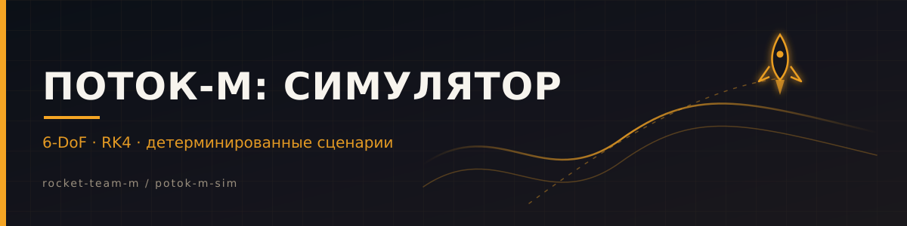
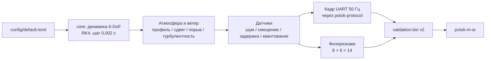

[](https://github.com/rocket-team-m/potok-m-sim/actions/workflows/ci.yml)

# Поток-М: симулятор

Детерминированный 6-DoF симулятор ракеты «Поток-М»: генерация данных для обучения бортового ИИ, отладка алгоритмов управления и регрессионные тесты.

> Инженерный прототип. Аэродинамика — плейсхолдеры; среда пригодна для отладки архитектуры и обучения, но **не является цифровым двойником** и не может быть единственным источником истины на пуске.

## Ссылки

- [BUILD_LOG.md](BUILD_LOG.md) — решения по физике и формату
- [potok-m-protocol](https://github.com/rocket-team-m/potok-m-protocol) — генератор кадров UART
- [potok-m-ai](https://github.com/rocket-team-m/potok-m-ai) — потребитель `validation.bin`
- [Спецификация идеального контура](https://github.com/rocket-team-m/potok-m/blob/main/SPEC_ENGINE_IDEAL.md)
- [Документация проекта](https://rocket-team-m.github.io/potok-m/)

## Архитектура



Динамика — 6 степеней свободы с переменной массой, RK4 с шагом 0,002 с, стандартная атмосфера, две ступени по паспортам РДК-2000 и РДК-1000. Статический запас — 0,75 калибра. Ветер: степенной профиль по высоте, сдвиговый слой, дискретный порыв 1-cos, коррелированная турбулентность. Датчики: гироскоп, удельная сила в связанных осях, магнитометр, барометр, Pitot.

Все случайные величины выводятся из `run.seed` и номера эпизода через `SplitMix64` и локальный `StdRng`; глобального ГПСЧ, часов и зависимости от числа потоков нет — последовательный и параллельный (rayon) прогоны дают идентичные эпизоды. 20 детерминированных ячеек сценариев: 16 обучающих и 4 отложенные (id 16–19). Граница проходит по сочетаниям ветра и порывов, а не по типам ракет. Критерий обобщения: RMSE на отложенных ≤ 1,25 × RMSE на обучающих. Эталонный оптимизатор — LQR-подобная обратная связь по полному состоянию, верхняя граница для модели с датчиков.

## Быстрый старт

```bash
cargo build --release
cargo test --workspace
cargo check --workspace
cargo run --release -p potok-cli -- --help

cargo run --release -p potok-cli -- --episodes 20 --physics-features \
  --split train    --validation-out validation/train/
cargo run --release -p potok-cli -- --episodes 20 --physics-features \
  --split held-out --validation-out validation/heldout/

cargo bench -p potok-sim --bench throughput   # эпизоды/с, кадры/с
```

`config/default.toml` задаёт 8 выходных каналов; `--physics-features` добавляет шесть производных (`alpha_deg`, `beta_deg`, `q_dyn_kpa`, `a_lat_resid`, `drag_est`, `static_margin_cal`) — итого 14. `--split train|held-out` оставляет одну сторону выборки. Без флагов все прежние команды работают как раньше. Каждая команда пишет `validation.bin` в указанный каталог.

## Структура

| Каталог | Содержание |
| --- | --- |
| `core/` | `potok-sim`: динамика, атмосфера, ветер, датчики, сценарии, формат валидации, эталонный оптимизатор |
| `cli/` | `potok-cli`: headless-прогон эпизодов, генерация валидации, дашборд на ratatui |
| `config/` | `default.toml`, профиль пограничного слоя |
| `vehicle/` | Решение по аэротрубным продувкам, расчёты Ansys/CAD |
| `BUILD_LOG.md` | Решения и результаты прогонов |

Канонический кадр — 56 байт, 50 Гц, little-endian, кодируется `potok_protocol::encode_request`; фазы протокола `BURN=0 … LANDED=4`. `validation.bin` v2: 80-байтовый заголовок magic `POTOKSIM`, на эпизод — `u64` индекс, 17 метаданных `f32` (9 исходных, 6 conditioning, `scenario_id`, флаг split), затем `frames × features` и `frames × 4` целей. Читается через `potok_sim::validation::read_validation`; версия 1 принимается для совместимости.

## Статус и ограничения

- **Аэродинамика — плейсхолдеры.** `cd0`, `cna`, `pitch_damping`, `roll_damping` и таблица `cd_mach` подобраны так, чтобы номинальная траектория попадала в район ТТХ; расчётной карточки OpenRocket/Ansys нет, неопределённость не оценена. Это главный источник расхождения.
- **Двигатель упрощён.** Форма кривой тяги, пусковой переходный процесс, пики и пульсации не моделируются — только средняя тяга и расход топлива с верхним значением импульса в паспортных диапазонах.
- **Нет реальной статистики ветра на высотах 0–3 км**, упругости корпуса, аэродинамики приёмника давления, парашютного спуска, продувок в аэротрубе и сравнения с лётным логом.
- **Расхождение с ТТХ.** Действующее ТТХ — M=0,5–0,6 (≈170–200 м/с) и апогей около 3 км. Номинальный прогон (seed 1337) даёт ≈203 м/с и ≈2,4 км: по скорости симулятор в диапазоне, по апогею не хватает. Доверять ему как единственному источнику истины на пуске нельзя.

## Лицензия

MIT.

## Truth-extended v2 metadata


`output.truth_metadata = true` (or `write_validation_with_truth`) writes
**version 3** with `meta_count = 39`: the classic 17 floats plus a 22-float
truth record captured at the episode's last 50 Hz tick. The header
`meta_count` is the authority; `read_validation` accepts 9 (v1), 17 (classic
v2/v3) and 39 (truth-extended v2/v3), so old files and old readers keep
working. `ValidationEpisode.truth` is `None` for the first two. This terminal
record is unchanged (no `g_accel`); the per-tick command target lives in the
v3 sidecar below.

| index (after the 17) | field | units |
|---|---|---|
| 0–2 | true wind vector at the tick (world X/Y/Z) | m/s |
| 3 | gust start (`-1` = none) | s |
| 4 | gust amplitude | m/s |
| 5 | shear-layer altitude | m |
| 6 | shear-layer velocity jump | m/s |
| 7 | shear-layer thickness | m |
| 8–10 | true position (world X/Y/Z) | m |
| 11–13 | true velocity (world X/Y/Z) | m/s |
| 14–17 | true quaternion `(w, x, y, z)` | — |
| 18–20 | true body angular rate (X/Y/Z) | rad/s |
| 21 | true mass at the tick | kg |

The terminal truth record above is per-episode (last tick only). For a
privileged LoopWM teacher, use the per-tick sidecar below.

#### Per-tick privileged truth sidecar (POTOKTRJ v2)

`write_trajectory` still writes **version 1**: 64-byte header (`POTOKTRJ`,
`version=1`, episode_count u32, frames_per_episode u32, `stride=6`, 40 reserved)
and `frames x 6` f32 per episode (`x, y, z, vx, vy, vz`). Every old reader and
binary file keeps working.

`write_trajectory_v2` still writes **version 2** with the same 64-byte header
and `stride=24` (unchanged bytes). The writer used by `generate-dataset` is
`write_trajectory_v3`, **version 3, `stride=26`**: the 24 v2 fields plus two
appended floats per tick. The v2 field order is:

| index | field | units |
|---|---|---|
| 0–2 | world position x/y/z | m |
| 3–5 | world velocity x/y/z | m/s |
| 6–9 | quaternion `(w, x, y, z)` | — |
| 10–12 | body angular rate x/y/z | rad/s |
| 13 | mass | kg |
| 14–16 | true wind x/y/z (world frame) | m/s |
| 17 | gust start (`-1` = none) | s |
| 18 | gust amplitude | m/s |
| 19 | shear-layer altitude | m |
| 20 | shear velocity jump | m/s |
| 21 | shear-layer thickness | m |
| 22–23 | reference optimizer `g_theta` `[roll, pitch]` | rad |
| 24 | `g_accel_y` (v3 only) | m/s² |
| 25 | `g_accel_x` (v3 only) | m/s² |

Indices 24–25 equal validation target columns 4–5 on the same tick, and the
fin command is again `[24, -25]`. `read_trajectory` accepts all three versions:
the header version and stride are the authority (6 / 24 / 26), and a v1 read
leaves the privileged fields at explicit defaults (`gust_start_s = -1`,
everything else zero), never at guessed values. A v2 read leaves `g_accel` at
`[0, 0]`. The order is pinned by `trajectory::TRUTH_TICK_NAMES` and
`TRUTH_V3_TICK_NAMES`. `g_theta` and `g_accel` are the reference optimizer's
targets; a `--control-file` run flies its own command and is not silently
substituted.

## Dataset manifest and quality gates

`generate-dataset --seed S --train-episodes M --held-out-episodes K --out DIR`
writes:

```
DIR/train/validation.bin                (v3, 17 metadata floats, 6 targets)
DIR/train/validation.trajectory         (POTOKTRJ v3, stride 26)
DIR/train/manifest.json
DIR/held-out/validation.bin
DIR/held-out/validation.trajectory
DIR/held-out/manifest.json
DIR/quality_report.json
```

Each manifest is deterministic JSON (schema version 1): effective config hash
(sha256 of canonical TOML), seed, split, sorted scenario ids, episode/frame
counts, feature/target/truth names, observed min/max bounds, and `sha256` +
byte count of `validation.bin` and its sidecar. No timestamps or process ids.
The model frame is the canonical 14 channels (eight raw + six physics).

Before writing the manifests the generator re-reads the files it wrote and
runs LOUD gates: finite values everywhere, disjoint train/held-out scenario
sets, feature limits, `g_theta` within +/-0.12 rad, `g_accel_*` within
+/-10 m/s², confidence/health in `[0,1]`, plausible truth (mass > 0, unit
quaternion, gust/shear in range),
consistent frame counts, at least `--min-episodes-per-split` (default 4), and
a full second generation whose four binary files must be byte-identical.
Any failure exits nonzero with the gate name and offending value; nothing is
clamped or skipped. `quality_report.json` records every passing check.

## Aero coefficient card

`[aero] source = "placeholder"` (default) keeps the legacy analytic model and
prints a **COUNTED** marker line to stderr on each `Simulator::new`
(`aero::placeholder_uses()` is the counter). `source = "card"` loads the 2-D
grid named by `card_path`, resolved like `boundary_profile`.
`config/aero_card.toml` is a documented example generated from the
placeholder coefficients: selecting it reproduces the current trajectory
bit-for-bit (covered by `generated_card_reproduces_placeholder_and_placeholder_is_counted`).

Each channel (`cd0`, `cna`, `pitch_damping`, `cm_delta`) is a rectangular grid
of `values[alpha][mach]` rows. Interpolation is bilinear and coefficients are
evaluated at each RK4 sub-stage. Any query outside a grid axis is a **LOUD**
`SimError::AeroOutOfGrid` (returned by `interpolate`, and propagated out of
`run_episode`); nothing is clamped. `cm_delta` adds a gimbal control moment
proportional to `q_dyn·A·D`; the example card sets it to zero.

## Sensor realism knobs

All new `[sensor]` knobs default to **off/zero**, so old configs and tests are
unchanged. `gyro_arw` / `accel_arw` are Allan angle/velocity random-walk
densities (discrete std = ARW / √dt); `gyro_bias_stability` /
`accel_bias_stability` drive a seeded random walk on the constant bias.
`latency_steps` delays whole frames; `gyro_quant_step` / `accel_quant_step`
override `quant_step` per channel; `mag_sat` / `baro_sat` add optional limits;
`spike_probability` / `spike_amplitude` inject a seeded measurement spike that
sets the canonical FAULT bit and gates the AI. Every draw comes from the
episode's `SENS` sub-seed, so runs stay reproducible.

`potok_sim::validation::read_validation` parses the format; a round-trip test
covers it. Note that an AI-side reader must use the v2 layout when consuming
files produced by the new writer.

## Reference optimizer

`g_theta = [roll, pitch]` is an LQR-style full-state feedback (lateral
position/velocity error → desired tilt, minus body-rate damping), clamped to
±0.12 rad, with an infinite-horizon approximation rather than a solved
Riccati equation or online MPC. It sees true state and wind, so it is an upper
bound on the sensor-only model. It is zeroed on pad/boost by the AI interlock.

The exported command target is **not** `g_theta`. `ReferenceOptimizer`
computes the same raw LQR demand `(ax, ay)` and clamps it to the actuator
envelope as `[ax, ay]` (`world_accel_command`); the dataset writes it as
`[g_accel_y, g_accel_x] = [ay, ax]`. The fin solver consumes
`fin_accel_command = [g_accel_y, -g_accel_x]` m/s² in `[roll, pitch]` order
and converts it to a fin deflection by a moment balance. Training on
`g_theta` instead of this pair was the cause of the negative closed-loop A/B;
`g_theta` remains as a diagnostic/legacy column only.
